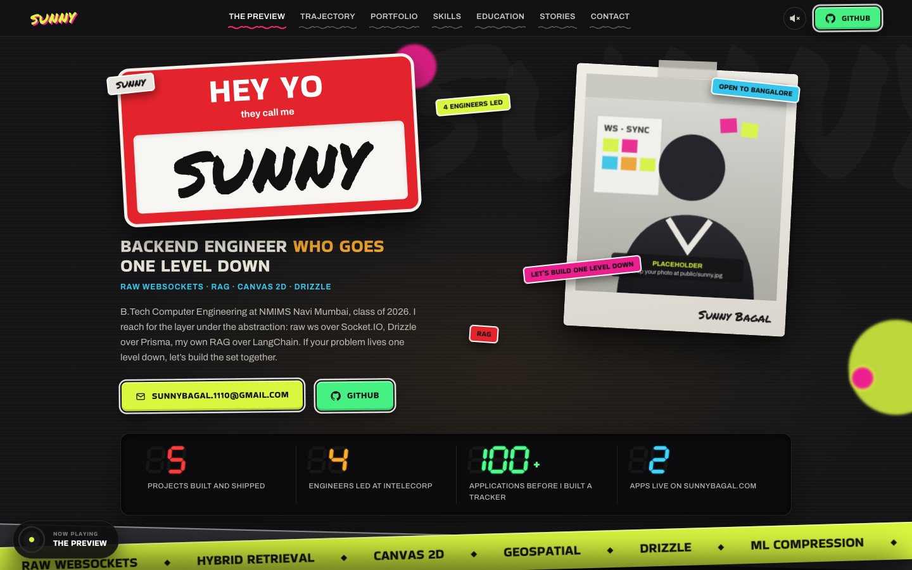

# Setlist

A street / hip-hop portfolio where the page is a DJ set. It has a name-tag hero, a turntable that plays my trajectory, a brick wall of project polaroids, draggable skill stickers, a crate of records for what I learned, three singles for stories, and a spray-paint wall to leave a tag on.

The layout, interactions and visual language are recreated from a screen recording of a Spanish-language portfolio. All copy is translated to English and the content is mine.



## Run

```sh
npm install
npm run dev          # http://localhost:5173
npm run build        # type-check + production build into dist/
npm run screenshots  # build, then save desktop (1440×900) and phone (390×844) shots to screenshots/
```

Stack: Vite 8.3.5, TypeScript 5.9.3, Playwright 1.64.1 for screenshots. There's no UI framework and no image assets. The bricks, record art, covers and spray cans are all generated in code, and all sound is synthesized with Web Audio.

## Sections

| Original (ES) | Here | What it does |
| --- | --- | --- |
| La previa | The Preview | "HEY YO they call me" name tag, polaroid, LED stat counters, lime marquee tape, paper card + pink note |
| Trayectoria | Trajectory | Turntable spins at 33⅓, the tonearm drops on play, click a track to swap the label and liner notes |
| Portafolio | Portfolio | Taped polaroids on a procedural brick wall, white logo tape marquee |
| Competencias clave | Key skills | Drag stickers anywhere, "Re-stick" springs them back |
| Formación | Education | Pull a record from the crate, Previous / Next through the card |
| Artículos | Stories | Album sleeves with the disc sliding out on hover |
| Contacto | Contact | Graffiti wall: 9 cans, 5 nozzles, size, pressure, drips / anti-drip, undo, clear, PNG export |

Also: sticky stacked sections (each one slides over the last), the "Now playing" pill with scroll progress, active-section nav underline, back-to-top, and a sound toggle (boom-bap loop while the deck plays, spray hiss on the wall).

## Content

All copy is in [`src/content.ts`](src/content.ts). Anything wrapped in `PLACEHOLDER()` renders with a dashed underline. These are still open:

- A photo: drop it at `public/sunny.jpg` and it replaces the drawn placeholder in the hero polaroid.
- CV PDF link.
- Lessons for the InteleCorp internship and the application sprint; the NeuralCompress result.
- Links for the three stories. Until a story has an `href`, its card isn't clickable.

## Changes from the original

- WhatsApp buttons became GitHub, and Medium became GitHub. There's no phone number.
- The ES/EN switch was dropped because the site is English only.
- The Awwwards "Nominee" side tab was dropped.
- Behance shots and client logos became drawings of Linea, Recall and TraceHound, plus a wordmark strip of my own places and projects.

## Known gaps

- The display face is Bakbak One, the closest Google Font to the original's chunky rounded headline type. The marker face is Permanent Marker.
- On phones, three of the five hero stickers are hidden to keep the name tag readable, and the now-playing pill collapses to its disc.
